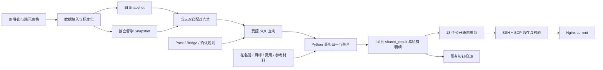

# 服务器数仓与 BI 架构升级：审计与分阶段方案

日期：2026-10-22（上海）。状态：方案待确认；未施工、未迁移客户数据、未修改生产链路。

> 本文保留早期审计时点的事实及实验记录。后续独立全量重导结果见 `shadow-bi-discussion-20261022.md`；本次正式施工计划入口为 [影子 BI 施工方案](shadow-bi-construction-plan-20261022.md)，不再按本文旧阶段表安排施工。

## 1. 结论与决策建议

建议采用“Grok 生产完整版本 → 服务器校验与发布不可变双仓版本 → Superset 只读查询”的路线。先保留 DuckDB，不预先增加业务查询数据库。服务器持有完整已接入历史，而不是只收聚合 JSON；Superset 和未来 Business Data MCP 使用同一正式 release、相同指标定义及权限范围。

关键工作不是搬文件，而是把现有 SQL＋Python 计算结果组织成可查询的业务明细和指标数据集，并处理版本切换、权限和查询资源边界。不能把现在的 landing 表直接交给普通业务用户后，声称已经复用全部口径。

当前可确认：本地双仓结构与规模、代码依赖、原发布机制、DuckDB 多进程只读与换版行为。不能确认：Grok 今天的执行状态、服务器 OS/CPU/内存/磁盘和完整 Superset 运行效果。现有 SSH 只读探测未成功，Project Intelligence MCP 隧道离线；不据历史回执冒充实时验收。完整 Superset UI、真实服务器并发和远端投送属于下一阶段隔离 PoC 的准入项。

用户参考对话《开源BI方案评估》的用户消息已读取：不采用只改静态页面的路线，优先直接查询服务器数仓。该对话助手回复仅返回内容引用，未取得完整正文，不将其当作技术证据。

## 2. 当前架构与数据流审计



主要拥有者及实际依赖：

| 层 | 当前实现 | 本次判断 |
|---|---|---|
| 采集更新 | `data_acquisition/jobs/rebuild_bi_warehouse.py`、`update_tencent_study_abroad.py`、`daily_warehouses.py` | 双源各自建仓，再用当天联合回执阻断失败/混批消费；保留 |
| 物理数据 | `data_platform/snapshots/ingest.py` | 表头原样 landing，DuckDB＋Parquet＋manifest，临时目录完成后改名；不原地覆盖 Snapshot |
| 受控查询 | `data_platform/query/service.py` | 显式 Snapshot、单条 SELECT、外部读取禁用、结果行数/字节数限制、查询证据；不是多用户查询服务 |
| 语义 | Pack 1.0.0、BI Bridge 1.7.0，另有留学确认规则与产品配置 | 不能只传 DuckDB 而漏传口径版本；也不能认为全部逻辑已经在 Bridge 内 |
| 指标计算 | `dashboard_product/management/sql/`、`facts.py`、`aggregate.py`、人员/渠道/费用模块 | SQL 取事实，Python 实现归属、去重、分摊、指标及展示期间；库里没有可直接替代这部分的业务视图 |
| 网页与通知 | `build.py`、`publication.py`、`monitoring_product/shared_delivery.py` | 同批结果驱动两类消费；私有通知/明细不进入公开 Web 根 |
| 现有发布 | `publish_management_dashboard.sh`、`activate_management_dashboard.sh` | 已有 incoming、逐文件 SHA/size、release、原子软链、失败回退；当前服务对象是静态资源，不是正式数仓 |

用户报告的“传不全”现象未在本次复现。当前源码已存在逐文件校验与原子静态发布，不能直接归因为缺少校验；需未来用具体失败批次区分上传、构建、缓存和显示问题。

### 2.1 本机实际双仓

通过 `Work/workspace.json` 和 `Work/StudyAbroad/current.json` 定位，不用 latest、mtime 或猜测目录。使用 Data Platform describe/query 核查；客户库没有被直接连接。以下是本机事实，不是服务器今天的数据。

| 仓 | 明确 Snapshot | 文件大小 |
|---|---|---|
| BI | `snapshot_bi_operations_20261013_local_103935` | 36,974,592 bytes（35.26 MiB） |
| 留学 | `snapshot_study_abroad_20261013_local_103935` | 2,371,584 bytes（2.26 MiB） |

| 业务关系 | 实际 COUNT(*) | 可用业务日期范围 |
|---|---:|---|
| `landing.br_work_orders__sheet_1f0596db9f25` | 58,784 | 分配时间：2025-03-01—2026-10-12 |
| `landing.br_cash__sheet_39b8dee2e4b3` | 70,110 | 业务日期：2024-06-01—2026-10-12 |
| `landing.study_abroad_market__resources` | 3,932 | event_date：2026-06-01—2026-10-12 |
| `landing.study_abroad_market__contracts` | 572 | event_date：2026-06-01—2026-10-11 |
| `landing.study_abroad_market__languages` | 398 | event_date：2026-06-01—2026-10-12 |

两个仓均另含 `ingest.sources`、`ingest.sheets`、`quality.issues`；受控 describe 返回的 5/6 个关系全部是 BASE TABLE，没有业务 VIEW。留学合同/资源有产品层去重规则，以上为落地行数，不是签约人数或有效资源数。上述日期字段未发现无法解析记录；两仓 quality.issues 当前为空，只说明现有检查未记录问题，不能证明业务口径完整正确。DuckDB 文件 SHA-256 均与各自 Snapshot manifest 一致。

本地联合指针为 2026-10-13 的 passed 配对；留学指针声明 through_date=2026-10-13，但最大事件日期并非都到 13 日。数据声明截止日、最大事件日期、看板截昨日的共同截止日必须分开。完整数仓指“当前已接入来源的完整历史和明细”；不能承诺缺失年份或业务系统从未导出的数据完整。

### 2.2 JSON 的角色与不能反推的数据

| 材料 | 实际内容 | 新 BI 的用法 |
|---|---|---|
| `shared_result.json` | 固定期间/团队指标、选择组合、元数据、查询回执和私有附件引用 | 对账基线；不是原始事实仓 |
| `online_shared_result.json` | 线上渠道/活动/费用等计算结果 | 核对现有线上业务定义；不能用预聚合人数再求和 |
| `details.json` | 已归一和筛选的事实及私有核对内容 | 可复用构建中的规范事实；不能替代被过滤的 landing 全量历史 |
| `site/*.data.json` | 面向页面裁剪/变换的展示数据 | 迁移时保留作页面对照，不作为未来 MCP 数据源 |
| `notifications.json` | 消息及附件任务 | 保留原通知消费合同，不塞进 BI 数据集 |
| Pack、Bridge、人员、目标、费用配置 JSON | 业务定义、确认决定或独立参考输入 | 分别保留拥有者、版本、SHA、有效范围；不是聚合结果 |

新筛选下的唯一人数、转化率、跨团队合计、多人分摊、自然月/绩效月、按状态过滤，必须从足够粒度的事实及对应规则重算。比率用同范围的分子/分母计算，不能平均已有比率；COUNT DISTINCT 不能加总分组人数。费用中只有周/月粒度的记录不能凭空拆成日费用，缺覆盖不能补零。

官方记分卡继续留在 `Input/Reference` 并保持独立权威范围，不混入 Snapshot/Bridge 数据行。当前 build 对其做历史对照且标记不可比；自由分析合同在覆盖范围内以记分卡为准。首轮语义验收必须显式列出两者适用范围，不能把迁移当成改变业务优先级的机会。

## 3. 差距分析

| 目标 | 当前差距 | 最小改造 |
|---|---|---|
| 服务器正式完整仓 | 现有部署发布静态资源；未核实服务器是否另存业务库 | 私有目录接收明确双仓及依赖闭包，独立于 Web 根 |
| 原子数据版本 | 单 Snapshot 不可变，但工作区刷新会清理旧运行，远端无已证实的数仓保留机制 | 服务器保留 release＋manifest＋前一正式版本；不能复制生产者清理策略 |
| 动态 BI | 聚合和人员规则仍在 Python，landing 缺业务就绪视图 | 复用现有函数，产出可查询规范事实与受控指标数据集，不重复实现一套公式 |
| 联合一致性 | 两仓分别发布，消费者依赖 daily 配对 | 一个 release manifest 同时绑定两个 Snapshot、计算版本与截止日，禁止单边切换 |
| 共享服务权限 | CLI 可信本地用户模型，无用户/部门授权 | 入口鉴权、数据集与行列授权、审计、资源限额；普通用户不能取得数据库路径或文件 |
| 查询可用性 | 行数限制发生在 execute 后，缺执行超时/并发配额 | 服务端 deadline、工作进程资源限制、队列/并发上限，禁止把 LIMIT 当扫描预算 |
| 身份与完整性 | 查询回执引用 manifest 中库 hash，查询前并非每次重算整个库 hash | 收件和发布时真实计算 SHA；验收后只读，日常查询复用已验证身份 |
| 版本切换 | 静态软链模式不能自动刷新数据库连接/缓存 | 停止新请求、排空或中止查询、切换、重建连接池、清缓存、验版，再开放 |

## 4. 迁移与持续同步设计

### 4.1 版本内容与统一数据源

首版保留两个原始 DuckDB 与各自 manifest，组成一个逻辑正式数仓 release，不为“统一”强行合并已有 Snapshot。建议目录（尚未创建）：

```text
/srv/oxhor/warehouse/
  incoming/<release_id>/
  releases/<release_id>/
    release_manifest.json
    raw/bi/{warehouse.duckdb,snapshot_manifest.json,...}
    raw/study/{warehouse.duckdb,snapshot_manifest.json,...}
    serving/business.duckdb
    semantics/（Pack、Bridge、确认规则、配置及版本摘要）
    evidence/（双仓回执、校验摘要、可重放查询引用）
  current -> releases/<release_id>
```

`serving/business.duckdb` 是同一 release 内可重建的业务查询投影，不是另一套权威来源。生产者调用现有规范事实和计算函数，按业务需要落地事实、维表与指标视图；BI 与普通 MCP 均查询它。授权高级查询若确需原始明细，显式绑定同 release 的原始仓，不能跨版本。首轮只开放一个已对账业务域，完整 raw 双仓仍保存在服务器。

Pack.metrics 继续是指标定义权威；已有公司/产品确认规则不被覆盖。新增数据集只做类型、粒度、权限与既有计算的投影映射。需要更细筛选而现有 facts 缺字段时，按既有 SQL 从原始表补对应字段，不能从 JSON 猜补。正式记分卡仍是独立 reference，由业务服务按其范围返回并标明来源，不伪装成数仓明细。

传输闭包必须包括已引用的 Snapshot artifacts（包括 Parquet 或明确说明的受控瘦身合同）、来源 lineage、Pack/Bridge、必要参考输入与查询/构建证据。原始 Excel 是否在服务器保留只按重建/追溯需要逐项列清单，不上传整个 customers/runs。本机原始输入只读；本阶段未上传。

### 4.2 持续发布协议

1. Grok 保持现有采集、标准化、完整历史合并与双仓门禁；每次调用固定代码版本，不让 Agent 在定时任务中临时改 SQL。
2. 新 Snapshot 完成计算后关闭所有写连接，确认 checkpoint 完成、无待应用 WAL；只打包稳定副本。不得复制正在写的数据库，也不得直接传到 current。
3. 生成不可变 release manifest：release_id、双 Snapshot/run、公司、各来源覆盖、Pack/Bridge 与规则/代码 SHA、DuckDB/构建运行时版本、完整路径/size/SHA 清单、行数、指标核对摘要。
4. 经固定主机密钥校验的 SSH/SFTP 进入私有 incoming。已有实现是 SSH＋`scp -O`，**并非已验证 SFTP**；沿用其完整性思想，PoC 实测 SFTP 子系统、失败重试/断点方式和权限。相同 release＋相同 hash 可幂等续传；相同 ID 不同 hash 必须拒绝。
5. 接收者拒绝路径穿越、软链、额外/缺失文件、大小或 hash 不符；检查空间、来源身份、双仓配对、schema、业务基线和覆盖变化。新版本不能仅凭“文件可打开”通过。
6. 校验完成后在同一文件系统把 incoming 改名为 releases；发布者持排他发布锁，按预期旧版本比较后切换，防止迟到批次覆盖新版本。
7. 进入短维护窗口，冻结 BI/MCP 新请求，排空/取消旧查询；原子换 current；所有查询进程重建池和缓存，以明确物理 release 路径连接；验版成功再开放。首版选择可验证的短窗口，不承诺无缝切换。
8. 写 activated 回执并回传 Grok；staged 不是 activated。看板/通知各自发布状态分别记录，不因服务器发布成功而重复推送。

每次请求固定一次 release_id，不在查询中反复解引用 current。Superset 一张看板包含多次请求，必须验收整个页面是否混版；切换时失效旧页面并要求刷新，不能仅在页眉换日期。缓存键绑定 release_id，Superset 数据库连接版本/缓存清理机制在 PoC 中验证；若做不到，使用隔离重启与短暂停服，不加入未经验证的“自动热切换”。

### 4.3 权限、版本、备份

- 文件置于私有数据根，上传账号只写 incoming；校验/激活账号负责发布；BI/MCP 账号只读服务所需文件，不能改 release、配置或 C 层凭据。沿用 SSH 身份并收窄能力，不沿用 Web 资源的公开读取权限。
- Superset 使用内置角色管理，关闭公开注册；若已有身份提供方能对接则复用，否则管理员分配最少账号。现有 Nginx 登录并不自动成为部门授权；MCP 连接权限也不自动代表每位业务用户的行权限。
- 初始保留策略建议：最近 7 个成功日版本＋4 个周版本，始终保留 active、previous 与被运行任务引用的 release。保留期和容量在 P0 确认；不能自动按年龄删除活动/引用版本。
- 备份包含完整已发布版本、manifest/口径、Superset metadata DB（图表/数据集/角色）、独立加密配置备份。密钥走 C 层；备份须有同故障域之外副本，目的地另行确认后才传。
- 建议验收目标：已发布版本 RPO=一个日更周期以内；数据版本回滚 RTO≤5分钟。灾难整机恢复单独演练，不能把软链回滚成绩当作备份恢复能力。

## 5. 关键技术验证与 Superset 最小验证

本阶段运行结果见 `.local/audits/server-warehouse-bi-20261022/`；实验仅使用合成数据、独立目录。未安装或启动生产 Superset。

| 验证 | 结果 | 能证明/不能证明 |
|---|---|---|
| 双仓 describe、实际行数、范围、quality、文件摘要 | 通过 | 证明本机明确版本结构；不证明源系统从未遗漏历史 |
| DuckDB 1.5.5 两独立进程同时只读 | 通过 | 文件式多进程读取可行；不证明服务器吞吐 |
| writer/reader 相互持锁 | 两方向均锁冲突 | 正式库必须只读，新版本另建 |
| A/B 原子换链 | 旧连接读 A，新/重开连接读 B；文件 SHA 不变 | 必须处理连接池和缓存；只换软链不够 |
| SQLAlchemy 方言 | 1.4.54组合通过；2.1.6列反射失败 | 版本约束有实际影响；不等于 Superset 应用兼容性验收 |
| SSH 当前服务器只读探测 | 未成功 | OS、资源、挂载、服务版本仍待核实 |
| Grok 当前例行与 SFTP | 未实测 | 10月历史同步回执只证明当时代码安装/运行 |

补充驱动实测：隔离环境使用 DuckDB 1.5.5、duckdb-engine 0.17.0。SQLAlchemy 2.1.6 在 `Inspector.get_columns()` 遇到 `pg_catalog.pg_collation` 缺失；官方 Superset 6.0.0/6.1.0 的依赖均要求 `sqlalchemy>=1.4,<2`。换用 1.4.54 后，schema/中文列反射、DECIMAL/DATE、日期筛选、分组、排序、LIMIT/OFFSET、只读拒绝 INSERT 和禁用外部 CSV 读取均通过。因此保留 Superset 优先路线，不因错误依赖组合引入替代数据库。[Superset 6.1.0 依赖源码](https://raw.githubusercontent.com/apache/superset/6.1.0/pyproject.toml)。

连接池另有实测：`engine.dispose()` 不会关闭已经 checkout 的旧连接；其仍可读 A，新 checkout 才读 B。切换必须先排空或关闭持有中的连接，不能只调用 dispose。上述是本机合成驱动结果，没有运行 Superset 应用、浏览器 UI 或服务器 Linux 压测。

Superset 官方列出 DuckDB 驱动 `duckdb-engine`。文件连接发生在 Superset 进程所在服务器，不需从用户电脑跨网络读取仓；容器要将服务器数据目录只读挂载到明确容器路径。驱动参数必须设置 read_only，并禁用外部文件/网络读取和扩展自动加载的可绕过路径。官方说明 Superset 不是数据库防火墙，因此不能依赖 UI 隐藏或 SQL 黑名单作为唯一安全边界。[连接说明](https://superset.apache.org/docs/databases/supported/duckdb/)；[驱动配置](https://github.com/Mause/duckdb_engine#configuration)；[安全边界](https://superset.apache.org/admin-docs/security/)。

Superset 自身还需 metadata DB 保存用户、图表和配置。PoC 可用临时 SQLite；生产应按官方建议使用受支持的 PostgreSQL/MySQL。这是 BI 应用依赖，不代表将业务 DuckDB 迁成 PostgreSQL。先核实服务器可复用服务；没有时把最小新增依赖及资源写入下一阶段方案，不隐瞒成本。首轮不启用报表定时、异步队列等非必要功能，Redis/Celery 是否需要随实测决定。[官方配置](https://superset.apache.org/docs/configuration/configuring-superset/)。

### 最小 PoC 和验收门槛（待执行）

固定 Superset 发布版、Python、SQLAlchemy、duckdb-engine、DuckDB 与镜像 digest；现有合成驱动测试的版本组合只作证据，不直接当作生产锁定组合。先合成数据验收，再在明确授权的私有服务器目录用冻结真实 release 对账。

| 项目 | 必做用例 | 通过标准 |
|---|---|---|
| 连接与模型 | 中文字段、日期/DECIMAL、schema 反射、只读容器挂载、两仓版本 | 正确反射，金额不丢精度，不能写库 |
| 首个业务域 | 语培市场工单明细与已确认业务组/渠道，外加现金及独立人数核对 | 同期同口径工单逐 ID、金额按分、人数按既有规则一致；不可比项显式标注 |
| 交互 | 时间/团队/渠道筛选，组合筛选，分组，升降序，分页，下钻到脱敏明细 | 不修改指标定义即可完成；翻页实际产生有界服务端查询，不能整表下载再分页 |
| 金额与人数 | 负现金、缺归属、删除/回收、重复学员、多人分摊、空值、自然月/绩效月 | 与现有验证样例及明确真实基线一致；留学/小语种不按姓名跨系统合并人数 |
| 完整发布 | 缺文件、截断、错误 hash、错误 Snapshot、单源失败、迟到/重复包 | 一律不切 current；旧服务仍可用；同包重试幂等 |
| 换版/回滚 | 多进程、连接池、看板多图、缓存、长查询、发布中断、恢复旧版 | 无混版显示；切换后全部请求和缓存版本一致；5分钟内回退且有回执 |
| 性能 | 代表性数据、冷/热缓存、5个并发业务用户＋MCP查询，持续15分钟 | 建议筛选/分组 p95≤3秒、初始看板≤5秒；无OOM/锁错误；超时可取消且进程继续服务 |
| 权限 | 两部门测试身份、越权过滤/导出/下钻/SQL、撤销权限后缓存 | 无越权结果；普通用户无 SQL Lab/原始文件访问；授权撤销及时生效 |
| 数据恢复 | 完整备份恢复到空目录，校验双仓与指标 | SHA、版本、口径一致；不依赖 Grok 当前旧文件仍存在 |

性能数值是建议验收目标，不是已测成绩。先确认真实同时在线人数与服务器预算再定最终门槛。若受控只读、限流、合理事实粒度后仍达不到并发/延迟要求，或部门隔离必须下沉数据库原生授权，再针对性评估服务器数据库；不把任何失败都归因于 DuckDB。

## 6. Business Data MCP 兼容性

现有 Project Intelligence MCP 只读项目结构，不能直接扩权限变为业务查询服务。未来新增薄业务工具适配层，复用现有受控查询及证据合同，不建设 Agent Loop、模型路由或 Session 管理器。

建议最小工具：查看当前正式版本/覆盖与指标目录；按已授权数据集、指标、维度和参数查询；按权限下钻；授权高级 SQL 查询。普通工具允许自由筛选/排序/分组/分页，但核心指标由固定定义计算，字段名/运算符来自允许列表，参数绑定；不让普通用户覆盖去重、业务日期、归属或分母。

当前 CLI 仍需补：可信调用者到部门/角色映射、行列权限、资源配额/超时、取消、稳定排序分页、审计与脱敏、服务可用性、release 固定绑定。现有 `ALLOWED_SCHEMAS` 和本地 SELECT 校验不是租户隔离；新 serving schema 及其源血缘须在 Data Platform 合同中显式扩展，不能绕过原有控制。查询结果保留 run、release、双 Snapshot、口径版本、覆盖日期、来源/回执与限制。

BI 和 MCP 复用同一份可审查授权映射，但各入口必须独立强制执行，不能假定 Superset RLS 自动传给 MCP。DuckDB 文件本身不提供业务部门用户权限隔离；普通用户不开放任意 SQL，高级 SQL 仅授予获准访问整个对应数据范围的可信分析角色。若要求高级 SQL 仍必须强行限制部门行数据，需隔离可见数据投影或改用支持数据库侧权限的方案，不能靠给 SQL 拼 WHERE 保证安全。

未来 Agent 可能把查询结果发送到其模型提供方。服务授权、返回字段/行数和可出域数据范围必须一起确认；本阶段没有新增外部数据传输。

## 7. 分阶段施工计划与回滚

| 阶段 | 产物与范围 | 准入/退出条件 | 失败回退 |
|---|---|---|---|
| 本阶段 | 本审计、真实本机证据、合成兼容探针 | 方案交付，生产不变 | 无生产回退动作 |
| P0 环境核对 | Grok 平台当前任务/解释器/磁盘/实际 import、SSH/SFTP、服务器系统/架构/资源/文件系统/现有服务/身份机制 | 读到真实回执，明确部署目录和容量；确认首个业务域及权限 | 不安装，不修改原任务 |
| P1 隔离 PoC | 独立 Superset、锁定依赖、合成数据与冻结版本，首个业务域可交互 | 第5节功能/权限/对账门禁通过；服务器资源实测 | 停隔离实例，生产静态页继续 |
| P2 正式数据发布能力 | manifest/收件/校验/原子激活/版本备份；只投送明确闭包 | 中断、坏包、混批、换版、回滚和恢复演练通过 | current 留旧版；不删除失败证据 |
| P3 灰度业务 BI | 既有 Grok 日更增加已验收投送步骤；小范围业务使用 | 建议连续7次日更发布成功、核心数值一致、性能/权限通过 | 回退 release及对应口径，恢复上一连接配置/缓存；原静态页暂作阶段回退 |
| P4 替换与 MCP | 验收 BI 后退役被替代静态发布；按需求开放业务 MCP | BI 验收完成、MCP 权限/出域边界确认 | MCP 可独立关闭；仍查询前一已验版 |

灰度期间保留既有静态服务是阶段回退，不建立永久兼容层。业务验收后删除替代入口及过时文档；通知仍是独立需求，其消费合同不要因换 BI 被误删。实施时更新原 `docs/architecture.md`、`SYNC.md`、部署/查询合同中受影响部分；当前这些文件仍描述现行架构，不提前改成已上线目标。

主要风险与处置：

| 风险 | 处置/阻断条件 |
|---|---|
| 口径散在 Python、SQL、Bridge、配置 | 固定源 hash、复用函数与规范事实，按真实基线对账；禁止另写近似指标 |
| SQL 直连绕过原查询守卫 | 只读 OS/挂载与 DuckDB 配置、最小角色、限制 SQL Lab、权限攻击测试 |
| 文件完整但业务错/覆盖缩短 | 对比来源范围、唯一键、关键指标；首次历史更正需业务解释，不按简单增减阈值自动通过 |
| 新旧双仓混合、缓存混版 | 单 release 双仓绑定；请求固定版本；短维护窗口、池回收、缓存失效 |
| 传输中断、磁盘不足、并发发布 | incoming隔离、预留空间、SHA、发布锁、回执、拒绝覆盖正式文件 |
| 旧版本仍被查询但已删除 | 引用保留/排空后清理，active与previous永不自动删除 |
| 服务器资源/共置服务未知 | P0核实；不修改或重启无关服务；无容量结论前不上生产 |
| Grok 登录失效/单源失败 | 保持现有双仓门禁，显示最后成功版本和过期状态，不空表发布或假装今日已更新 |
| 备份与生产同机损坏 | 独立故障域备份及恢复演练；仅保留多 release 不等于灾备 |
| Superset 升级和驱动漂移 | 锁定并记录兼容组合；依赖升级先隔离复测，不跟随 latest |

回滚顺序：冻结新请求 → 保存失败回执 → 选明确上一 verified release → 恢复其数据与口径绑定/连接配置 → 清池清缓存 → 核对版本和关键指标 → 恢复访问。数据回滚不触发补抓或钉钉补发；已发消息通过原 DeliveryState 去重。Superset 应用/metadata schema 升级与日常数据发布分开，前者需要独立备份和应用版本回退计划。

## 8. 证据索引与未完成项

本机证据目录：`.local/audits/server-warehouse-bi-20261022/`。

- `inventory.json`：两仓身份、受控查询回执、实际行数、日期范围、质量摘要与 manifest 校验；`bi-schema.json`、`study-schema.json`：字段与关系结构。
- `source-hashes.json`：本次审阅主要源码/文档版本；工作树原有未提交改动保持不动。
- `run_server_audit_*/data/query_results/`：本次每次受控查询的 SQL、参数、结果与 receipt。
- `probes/results.json`、`probes/duckdb_runtime_probe.py`：合成多进程/锁/换版验证；本机 macOS 结果不能替代 Linux服务器验证。
- `probes/dialect-probe.py`、`probes/dialect-probe.json`：SQLAlchemy 2.1.6 失败组合；`probes/sqla14/dialect-probe.json`：1.4.54通过组合。使用 `/tmp` 独立环境，项目 `.venv` 依赖未更改。
- `server-readonly.json`：只读 SSH 未成功；未上传、未重启或改配置。
- 历史参考：`SYNC.md` 及 `.local/sync/inbox/school-sort-20261015/receipt.json`，仅用于说明既有 Grok 安装路径及同步机制。

下一阶段仍需实测：远端 OS/资源/服务、Grok 当前例行及 SFTP、完整 Superset 版本兼容、真实数据业务对账、角色/行列权限、端到端换版/缓存、并发性能、备份恢复。以上均不能从当前合成测试推定通过。
